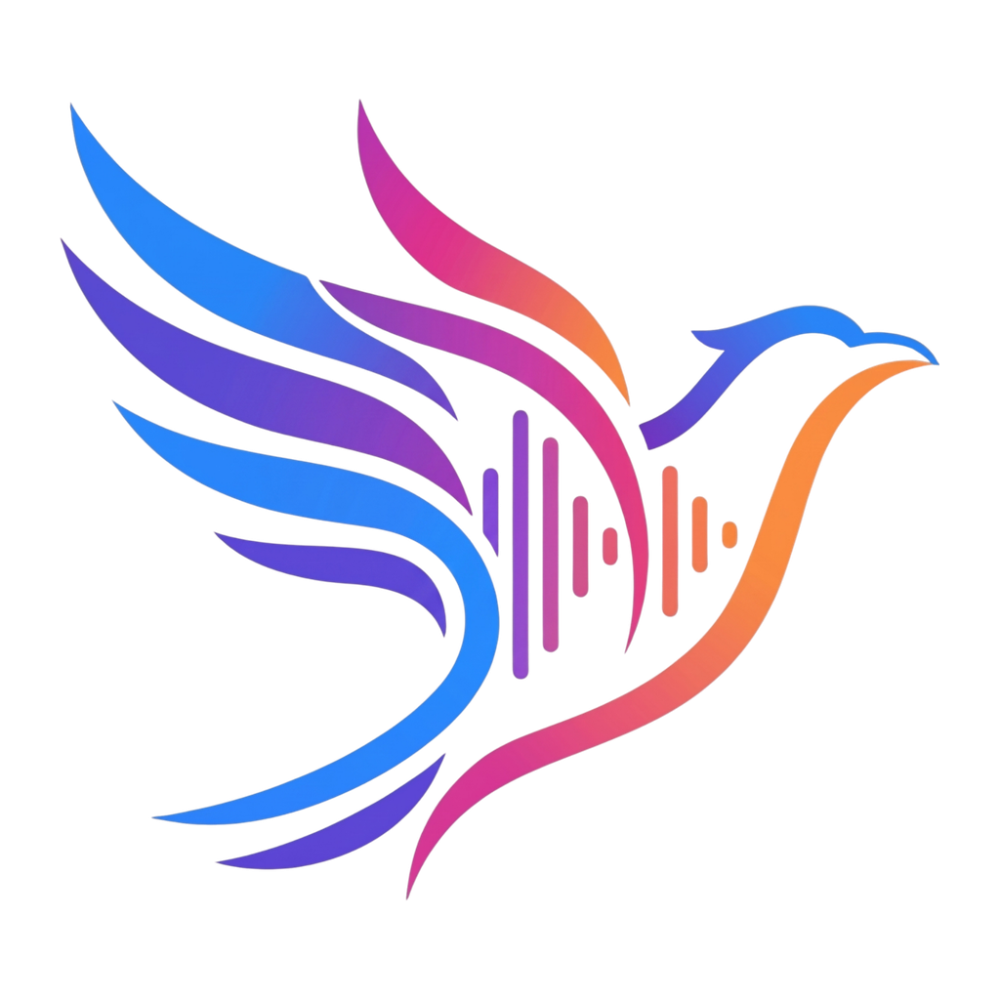
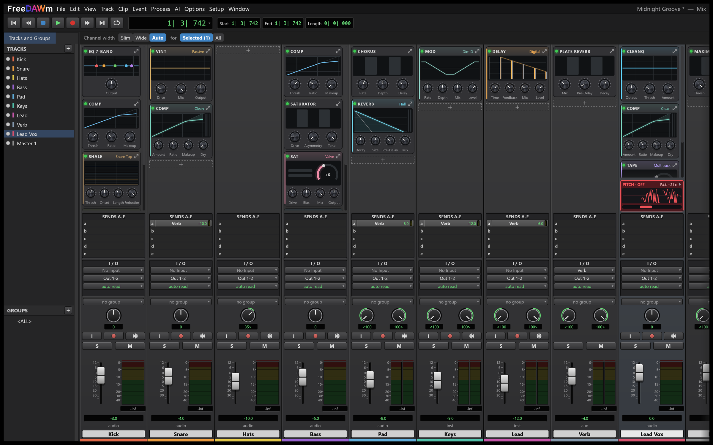
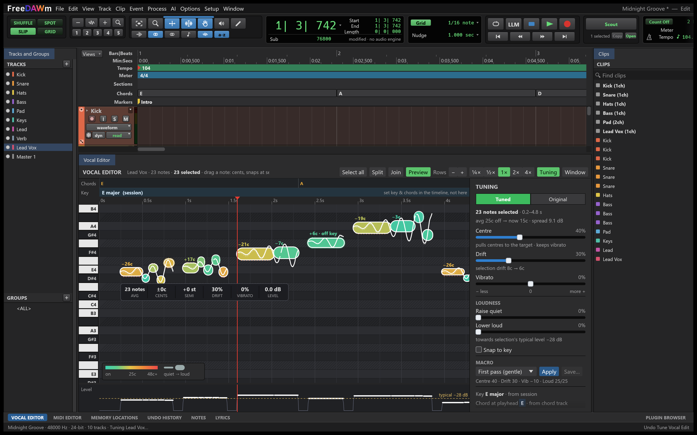
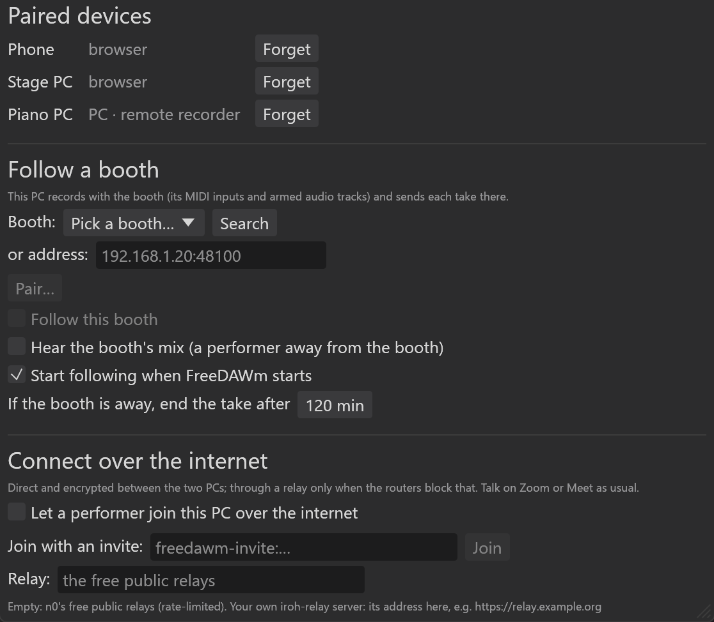

<p align="center">
  
</p>

<h1 align="center">FreeDAWm</h1>

<p align="center">
  <b>One free DAW with everything you need to make and record music, start to finish.</b><br>
  Open source, written in Rust. MIT or Apache-2.0.
</p>

<p align="center">
  <a href="https://github.com/s0lidr0ck/FreeDAWm/releases">Releases</a> ·
  <a href="https://github.com/s0lidr0ck/FreeDAWm/issues">Issues</a> ·
  <a href="CONTRIBUTING.md">Contributing</a> ·
  <a href="docs/control-protocol.md">Control protocol</a>
</p>

<p align="center">
  
  <br>
  <sub>The Mix window: FireStation plugins in every channel's chain, and the pitch box on the vocal strip showing the note being sung and how far off it is.</sub>
</p>

## Why FreeDAWm

Making a finished record usually means a pile of paid apps: a DAW, a plugin bundle, a pitch
editor, a vocal cleanup tool, a stem splitter, a drummer plugin, a subscription or two. I wanted
one program that does all of it, and I wanted it to be free.

FreeDAWm is that program. You write the song, record it (one mic at home or a whole band across
several PCs), edit it, tune the vocals, mix it with a full set of studio-grade plugins, master it
and export it, without buying anything else. The AI tools run on your own computer, so there's no
account and no per-use fee.

## What's in FreeDAWm

FreeDAWm is a fork of SoundCraft (see [Based on SoundCraft](#based-on-soundcraft)), which gave it
a solid editor, mixer and engine. Most of what's listed below was built for FreeDAWm on top of
that.

### Record

- **Audio recording** with punch in/out, pre/post-roll, loop recording, and input monitoring
  through the full channel strip. Autosave with crash recovery.
- **Audio interfaces set up for tracking.** The mix runs at your device's buffer size. Inputs and
  outputs have names. Input monitoring has three states (auto, on, off for direct monitoring),
  and Low Latency Monitoring bypasses the latent plugins on live tracks. A record offset is kept
  per interface, and you can measure it with a loopback cable.
- **Hardware MIDI input.** USB keyboards and an interface's 5-pin MIDI In play and record. Setup ›
  MIDI Input Devices has enable switches, activity lights and MIDI Thru. Choose each track's input
  as all inputs, one port, or one channel. MIDI recording supports punch, a take per loop pass,
  and Input Quantize.
- **Musical Typing.** The computer keyboard and the on-screen MIDI Keyboard work as a live MIDI
  input.
- **Count-off** before a take (the Count Off button on the toolbar).
- **Sticky loop.** The edit selection becomes the loop and stays after you click away.
- **Comping with take layers.** Each pass gets its own layer under the track. Swipe the best parts
  into the comp, or step a section through the takes with Up/Down. Classic playlists still work.
- **Record across several PCs and from a phone.** See [Collaborate](#collaborate).

### Write

- **The Band.** The six session musicians from the FireStation MIDI Studio plugin, inside the
  session. Lay out Sections and Chords lanes, pick a player and an energy level, and they play your
  installed instruments. **Print** turns their parts into MIDI clips you can edit. The engine is a
  line-by-line port of MIDI Studio, checked event for event against the original.
- **Instruments:** a subtractive synth, a drum synth and a sampler are built in. CLAP, VST3 and
  Audio Units instruments are hosted.
- **Chords and key.** The Chords and Key rulers are edited directly on the timeline. The chord
  picker names the chord you're playing on your MIDI keyboard. Chords can also be imported from a
  MIDI file or detected from audio.
- **Lyrics tab.** Write the song with line numbers, syllable counts and stresses, and rhymes
  coloured by type (perfect, slant, multi-syllable, internal). Lines that don't fit their partner
  line are flagged. The **Word Finder** gives rhymes by syllable count and stress, synonyms and
  definitions; one click puts a word in the line. You also get alternate lines, saved drafts, a
  hook counter, and *Copy for AI*. All of it works offline, with the CMU Pronouncing Dictionary and
  WordNet built in.
- **Lyrics ruler and Teleprompter.** Place lyric lines on the timeline. The Teleprompter shows big
  lyrics that follow the playhead, docked or in its own window.
- **Notes tab.** A to-do list for the session, with done boxes, #tags and notes pinned to a time.
- **Tempo.** Tempo and meter maps with ramps. **Detect Tempo** finds the beats, the song start and
  tempo changes, with a preview and an audition before you apply it. Tempo markers can be dragged,
  typed, added and deleted right on the Tempo ruler.
- **Session templates and track presets.** Start new songs from your own setups.

### Edit

- **The editing basics:** Shuffle, Slip, Spot and Grid modes. Smart, Trim, Selector, Grabber,
  Pencil and Scrubber tools. Separate, heal, consolidate, strip silence, fades and crossfades, clip
  gain, playlists, edit groups, and undo for everything.
- **Clip tools added in FreeDAWm:** a clip gain handle right in the waveform, duplicating a clip
  to another track, automation that follows clips when you move them, and markers you can drag
  along the ruler.
- **Split into Files.** Record a whole set as one session, then Edit › Split into Files cuts every
  track at your song markers. Each song on each track gets its own file (`<track> - <song>`).
- **Straighten.** Conforms a live recording to a steady tempo. It's phase-coherent across all
  tracks, so a drum kit's mics stay aligned, and a *keep feel* amount sets how far each beat moves.
- **Timing tools:** pitch-preserving time stretch, beat detection and conform to tempo.
- **Process menu.** Offline processing on a selection: normalize, reverse, gain, EQ, dynamics,
  pitch and time shift, reverb, and more.
- **The MIDI Editor.** Piano roll with velocity and controller lanes (CC, pitch bend, sustain,
  aftertouch). Note audition, Snap to Scale and a Change Velocity dialog. It can open in its own
  window. A score view and event list are also included.
- **MIDI Cleanup** for transcribed piano. It fixes wrong notes, pedal held over chord changes,
  legato and note length, following the chord track. It plays as a preview until you Commit.
- **Automation editing.** Curved segments, selecting and moving many points, a Pencil that
  overwrites, lanes for sends, trim, panners and hosted plugin parameters, and live writing from
  every control.
- **Editable keyboard shortcuts** (Setup › Keyboard Shortcuts) and a Preferences window.

### Vocals

- **Tune Vocal.** Note-based pitch and level correction on audio clips; no ML model needed. Vocal
  tracks are analysed in the background. You get Centre, Drift, Vibrato and loudness sliders, Snap
  to key, macro presets, and you can drag any note (in cents, snapping at semitones). It's
  non-destructive: switch Tuned/Original, and Commit when you're happy.
- **The Vocal Editor.** A piano roll of the singer's notes, coloured by how far off they are and
  drawn thick by loudness. It shows the original and tuned pitch curves, breaths, and scoops (Keep,
  Smooth or Shorten), with the chords and key above. Split and join notes, preview a note soloed,
  or open the editor in its own window.
- **See who's off at a glance.** The *waveform + pitch* track view draws each note over the
  waveform. Every vocal channel in the Mix window has a pitch box with the current note and its
  offset, and *Centre note* / *Flatten drift* buttons.
- **Clean Vocal.** De-noise (DeepFilterNet 3, built in) and de-reverb, in Vocal or Speech mode.
  It's non-destructive, with an Amount control and an Original/Cleaned switch on the clip.
- **Comping** with take layers (see [Record](#record)).

<p align="center">
  
  <br>
  <sub>The Vocal Editor on a synthetic test line, with the Tuning panel on the right.</sub>
</p>

### Mix

**The FireStation plugins** are the centre of the mixer: eighteen processors that cover what you'd
otherwise buy as a paid plugin bundle. They were ported from their C++ sources to Rust and checked
against the originals' renders. Each one keeps its original editor (translated) and has a slim
version for the narrow Mix drawer. All have factory presets, and your FireStation user presets
import with File › Import.

| Plugin | What it is |
|---|---|
| **Comp** | Compressor: ten styles in three lanes (parallel, multiband or serial) plus a dry fader |
| **CleanQ** | 24-band dynamic EQ with a dynamic ceiling (learn or draw it) |
| **Vint** | Vintage EQ and colour boxes: seven circuits, four of them passive/active EQs solved by nodal analysis |
| **Sat** | Tube, transformer and tape-style saturation |
| **Tape** | Tape machine: saturation, compression, wow/flutter, head bump |
| **Transient** | Transient shaper: attack and sustain on anything |
| **Shale** | Drum gate with lookahead, DeBleed, Kit Link and mic phase alignment; can send a MIDI note per hit to an instrument track |
| **LevelUp** | Loudness-matched A/B, reference tracks, BS.1770 delivery metering, dither |
| **Twine** | Mastering clipper and true-peak limiter |
| **Amp** | Seven tube amps solved from their schematics, with built-in or impulse-response cabinets |
| **Dist** | Twelve component-level drive, overdrive and fuzz pedal circuits |
| **Mod** | Fourteen modulation circuits: choruses, flangers, phasers, tremolos, vibratos |
| **Filter** | Envelope and auto filters with manual, envelope, LFO or step modulation |
| **Pitch** | Octaver, harmonizer and whammy effects |
| **Swale** | Automatic volume swells |
| **Delay** | Six voicings (digital, rack, BBD, tape, drum, oil can), host sync, freeze, reverse, multi-head |
| **Reverb** | Room, hall, plate, spring, cloud and shimmer |
| **ChamberMade** | A reverb chamber you build: room, materials, speaker and mic placement |

Where a mode models a piece of hardware, the app says so ("Component-level model of…" or
"Modelled after…"), with a no-affiliation note. The names belong to their owners; see
[NOTICE](NOTICE).

The rest of the mixer:

- **Channel chains.** Each channel holds up to 32 modules in any order. Tiles show a live graph
  and the key knobs, on wide or slim strips. The drawer opens in place, and any tile opens the full
  editor. Automation and state follow a module when you move it.
- **Sidechains** on modules, with cycle protection and latency alignment.
- **Freeze** is a real render through the live plugins. **Freeze up to here** leaves the modules
  after that point live. Instrument tracks freeze too.
- **Solo follows the signal path.** Soloing a bus keeps the tracks feeding it audible; soloing a
  track keeps its busses and returns audible. The S keys show these implied solos.
- **The Mix view:**
  - a compact pitch box (strips without one give its room to the inserts)
  - the mouse wheel scrolls the mixer while knobs ignore it
  - channel width for many channels at once
  - readable send levels and Expanded Sends
  - Alt for all tracks, Alt+Shift for the selected ones
  - click a meter to clear its clip light
  - a transport bar over the strips
- **Window › Sync** keeps the Edit and Mix windows in step (folders, selection, scrolling,
  visibility), with Mix in its own window on a second screen.
- **Plugin browser.** Instruments, effects and presets as cards showing each plugin's own window.
  Drag one onto a track or slot. Presets for hosted plugins load in place.
- **The mixing basics:** busses, aux inputs, VCAs, folders, pre/post sends, automatic delay
  compensation, and surround up to 9.1.6. CLAP, VST3 and Audio Units plugins are hosted, with their
  own editors and their state saved in the session.

### Master and deliver

- **Twine** (clipper and true-peak limiter) and **LevelUp** on the master. LevelUp does
  loudness-matched A/B against your reference tracks and delivery metering, with dither.
- **Scout** can compare your mix with a reference's sound profile (see [AI tools](#ai-tools-that-run-on-your-computer)).
- **Bounce** the mix or the loop to WAV, AIFF, FLAC, MP3 or Opus. The bounce reports peak, true peak and
  loudness (LUFS). Bounce and freeze render through the live plugin instances, so hosted
  instruments sound the same as in playback.
- **Export** stems, clips, MIDI, MusicXML scores, and lyrics as LRC or text.
- **DAWproject** import, with a report of what came across, and export, for moving a session to
  or from another DAW.

### AI tools that run on your computer

Free, local and private. They run on the CPU, or on Windows on the GPU through DirectML (any
DirectX 12 card, no CUDA install). Each job shows progress and can be cancelled, and the result is
one undo step.

- **Separate Stems.** Choose HTDemucs (4 stems) or BS-RoFormer SW (6 stems: adds guitar and piano).
  **Best of each**, the default, takes the vocals from Mel-Band RoFormer and the other stems from
  SW.
- **Make Karaoke** (lead vs backing vocals) and **Split Drums** (kick, snare, toms, hi-hat, ride,
  crash).
- **Convert to MIDI** with four models: general, piano (with sustain pedal), drums and vocal. It
  can isolate the instrument first, and you can audition the result before converting.
- **Detect Chords** onto the Chords ruler. **Transcribe Lyrics** (Whisper large-v3) puts timed
  lines and words on the track.
- **Generate MIDI from Text** (MIDI-LLM). Describe the music ("upbeat jazz with saxophones,
  B-flat major") and get one instrument track per General MIDI instrument at the edit cursor,
  ready for your own instruments. A seed repeats a piece.
- **Generate Song** with YuE2 or ACE-Step 1.5: a whole song with vocals onto an audio track, and with
  YuE2 the score it sang as MIDI tracks (melody, accompaniment, chords). Download an engine in
  Setup › ML Models (about 4.4 GB) and FreeDAWm runs it itself, on the GPU when there is one
  ([yue2.cpp](https://github.com/ServeurpersoCom/yue2.cpp),
  [acestep.cpp](https://github.com/ServeurpersoCom/acestep.cpp) inside).
- **Clean Vocal** and **Tune Vocal** (see [Vocals](#vocals)).
- **Scout: mix feedback.** Select channels, press **Scout** and play. Scout measures each channel
  before and after its processing: spectrum, loudness, dynamics, stereo width, transients. It
  packages that with the real track names, chains, settings and routing. Ask a question in the
  Scout panel with your own Anthropic API key, or **Copy** the package into any chatbot. EQ
  suggestions come back as guides drawn on CleanQ's graph. **Scout never changes the mix**; you
  make every move. **Sound profiles** capture a target (from a channel, a clip, a reference file
  or a separated stem) for Scout to aim at.

The models are not bundled. They're downloaded from their authors' own pages and installed with
`cargo xtask ml-models`. Setup › ML Models shows each model's licence status; some are
non-commercial or state no licence (see [ATTRIBUTION.md](ATTRIBUTION.md)). De-noise needs no
download.

### Collaborate

- **A phone as the remote.** Setup › Network › *Allow control from this network* (off by default)
  serves a web page on port 48100. On a phone or a stage PC you get Record, Play, Stop
  (press-and-hold while recording), Arm All, Add Marker, track meters, and the disk space left on
  every PC. Devices pair with a 4-digit code shown on the main PC's screen.
- **Several PCs, one recording.** Another PC running FreeDAWm can *follow the booth*. It records,
  plays and stops with the main PC at the same timeline position, so a keyboard player's MIDI rig
  or a guitar PC records along. While it records, the main PC's track shows a live sketch of the
  MIDI or the audio level. At Stop, takes arrive note for note, or as FLAC in the project's
  format, with clock drift corrected. In tests MIDI lands within 0.15 ms and audio within a few
  samples. Takes wait on disk and are sent again if the link drops.
- **Remote performers over the internet.** Send a one-time invite, valid for 30 minutes. The
  connection is direct and encrypted ([iroh](https://iroh.computer)) and falls back to a relay
  when routers block it; you can run your own relay. The performer hears your live mix (Opus),
  and their take lands where they played against it. They also get a level window with a big
  meter, a clip light, plain advice and a 10-second level check.

<p align="center">
  
</p>

### Under the hood

- **Big sessions open fast.** Audio plays from disk through a cache sized to your RAM. In testing,
  an hour-long 16-track session reopens in about half a second (it took about 17 seconds before),
  and plays with no dropouts.
- **The project folder holds everything:**
  - recordings and imports in `Audio Files/`
  - stems, Clean Vocal, tuning, freeze and processed audio in their own subfolders
  - a waveform cache
  - `Bounced Files/`
  - the last ten session backups

  Imported audio and plugin files (amp IRs, reference tracks) are copied in, so you can move the
  folder to another computer as it is. Details: [docs/project-folder.md](docs/project-folder.md).
- **Plugin stability.** VST3 plugins are scanned in a separate process, so a plugin that crashes
  or hangs while scanning doesn't take FreeDAWm down. The VST3 host now provides the messaging
  and restart handling some plugins rely on. Plugin editors keep drawing during playback and open
  fully on one screen.
- **GPU recovery.** If the graphics driver resets, FreeDAWm autosaves, opens a new window on a new
  graphics device and keeps going. The session and the audio carry on.
- **Every action is a command** (see [below](#every-action-is-a-command)).

## Getting started

### Download

Builds will appear on the [releases page](https://github.com/s0lidr0ck/FreeDAWm/releases).
Release builds for Windows, macOS and Linux are being set up now; until then, build from source.

- **Windows:** public builds use WASAPI. ASIO is available only in builds you make yourself with
  the Steinberg ASIO SDK, and such a binary is GPLv3. See
  [docs/release-playbook.md](docs/release-playbook.md).
- **macOS:** builds are not signed yet. The first time, right-click the app and choose **Open**.

### Build from source

You need:

- Rust 1.95 or later
- CMake and libclang, for Transcribe Lyrics (it builds whisper.cpp)
- on Linux, the ALSA headers (`libasound2-dev` or `alsa-lib-devel`)

```sh
git clone https://github.com/s0lidr0ck/FreeDAWm
cd FreeDAWm
cargo run --release -p soundcraft -- --demo     # the app (freedawm), with the demo song
cargo run --release -p soundcraft-cli -- --help # the command line (freedawm-cli)
```

The cargo packages and crates keep their `soundcraft-*` names from the fork. The programs,
settings folders and `FREEDAWM_*` environment variables are FreeDAWm's. For ASIO on Windows, run
`cargo xtask build-asio` (needs the ASIO SDK and LLVM).

### ML models

```sh
cargo xtask ml-models        # downloads, converts and installs the models
```

This needs a Python environment with PyTorch, set up as described in
[tools/ml-export/README.md](tools/ml-export/README.md). The download is about 1.5 GB. Models
install into `%LOCALAPPDATA%\FreeDAWm\models` (or `FREEDAWM_MODELS_DIR`). Setup › ML Models shows
what's installed and each model's licence. The AI tools are in the desktop app only.

### First steps

- <kbd>Space</kbd>: play/stop
- <kbd>Ctrl</kbd><kbd>=</kbd>: switch between Mix and Edit
- <kbd>Enter</kbd>: new marker
- <kbd>Ctrl</kbd><kbd>Shift</kbd><kbd>N</kbd>: new tracks

Every shortcut is listed, and can be changed, in **Setup › Keyboard Shortcuts**. The layout
follows the Edit/Mix workflow many engineers already know: edit modes, tools, playlists, memory
locations.

## Every action is a command

Everything you can click is also a command with an id and JSON parameters. The same commands work
from the menus, the keyboard, the command line, a JSON control channel, paired PCs on the network,
and an [MCP](https://modelcontextprotocol.io) server. Scripts and AI agents can drive FreeDAWm.

```sh
# Headless: load the demo, turn the kick down, put a FireStation Comp on the bass, bounce.
freedawm-cli run --demo \
  --cmd 'mix.volume={"track":"Kick","db":-6}' \
  --cmd 'mix.module_add={"track":"Bass","plugin":"fs_comp"}' \
  --bounce mix.wav

# Drive the running app.
freedawm --demo --control 7801 &
freedawm-cli app --port 7801 transport.play

# Give an AI agent a DAW (Claude Code shown).
claude mcp add freedawm -- freedawm-cli mcp --demo
```

`freedawm-cli commands` lists every command. Details: [docs/control-protocol.md](docs/control-protocol.md)
and [docs/mcp.md](docs/mcp.md).

## Troubleshooting

**Logs.** The app writes `logs/freedawm.log` in its settings folder:

- Windows: `%APPDATA%\FreeDAWm\logs\`
- macOS: `~/Library/Application Support/FreeDAWm/logs/`
- Linux: `~/.config/freedawm/logs/`

The previous two runs are kept as `freedawm.1.log` and `freedawm.2.log`. Attach the log to a bug
report.

**The app doesn't open on Windows.** FreeDAWm uses DirectX 12. To try another backend, set
`WGPU_BACKEND` (for example `vulkan`) before starting `freedawm.exe`.

| Variable | Effect |
|---|---|
| `RUST_LOG` | Log levels (default: `info` for FreeDAWm, `warn` for the rest) |
| `FREEDAWM_NO_PREFS` | No preferences read or written, no log file (test runs) |
| `FREEDAWM_NO_SPLASH` | No launch animation (also `--no-splash`) |
| `FREEDAWM_DISK_CACHE_MB` | Size of the decoded-audio cache (default: a quarter of RAM, 512 MiB to 6 GiB) |
| `FREEDAWM_STREAM=0` | Load every audio file into memory instead of playing from disk |
| `FREEDAWM_MODELS_DIR` | Where the ML models live |

**Coming from SoundCraft?** On first start FreeDAWm copies your old SoundCraft settings folder
and leaves the old one as a backup. `.scraft` sessions still open; new sessions are saved as
`.fdawm`.

## How it's built

A Cargo workspace of small crates with strict layering: nothing below the UI knows about egui.
FreeDAWm added these crates:

- `soundcraft-band`: the Band
- `soundcraft-ml`: local ML
- `soundcraft-vocal`: vocal tuning
- `soundcraft-net`: the network
- `soundcraft-plugin-scan`: out-of-process plugin scanning

Errors are values, not panics: a bad file or a bad command gives a message, never a crash.
`cargo xtask ci` runs formatting, clippy, the tests, the asset and layering checks and the
WebAssembly build.

## Status

FreeDAWm is under active development. It's tested mainly on Windows so far; macOS and Linux build
but have had far less use. Some features are still being checked on real rigs: recording across
PCs, the Band with third-party instruments, and hardware MIDI. Expect rough edges, and please
report them in the [issues](https://github.com/s0lidr0ck/FreeDAWm/issues). The detailed status is
in [ROADMAP.md](ROADMAP.md) and [docs/gaps.md](docs/gaps.md).

Contributions are welcome. [CONTRIBUTING.md](CONTRIBUTING.md) has the build steps and the rules
for pull requests.

## Based on SoundCraft

FreeDAWm is based on [SoundCraft](https://github.com/storytold/soundcraft) by the ArtCraft team
and its contributors. Their editor, mixer, file formats, plugin hosting, automation, MIDI,
notation, video and command system are the foundation everything above is built on. Thank you.

FreeDAWm is an independent fork. It is not an ArtCraft product and is not endorsed by the
ArtCraft team.

## License

FreeDAWm is dual-licensed under [MIT](LICENSE-MIT) or [Apache-2.0](LICENSE-APACHE), at your option.
Copyright (c) 2026 FireStation (the FreeDAWm owner) and the FreeDAWm contributors; based on
SoundCraft, copyright (c) 2026 ArtCraft Team and the SoundCraft contributors.

The FreeDAWm logo, wordmark and splash, the FireStation presets, the Band library and the amp
impulse responses are the owner's own work, also released under MIT. Bundled fonts, lexicons and
other third-party material keep their own licences, listed in [ATTRIBUTION.md](ATTRIBUTION.md).
Third-party ML models are not bundled.

**Trademarks.** Some modes, presets and impulse responses name the hardware they model or were
measured from. Those names, and other product and company names in this repository, belong to
their owners. FreeDAWm is not affiliated with or endorsed by any of them. See [NOTICE](NOTICE).
