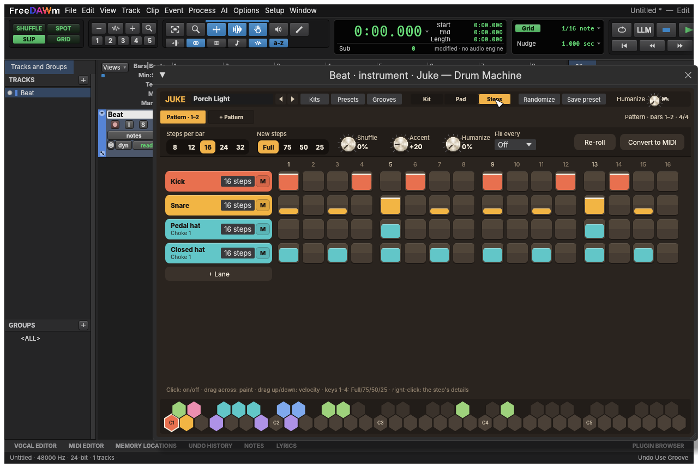
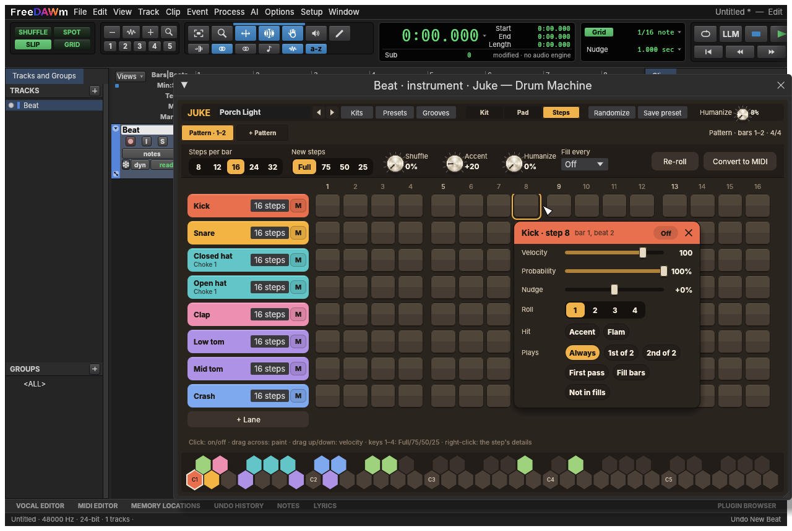
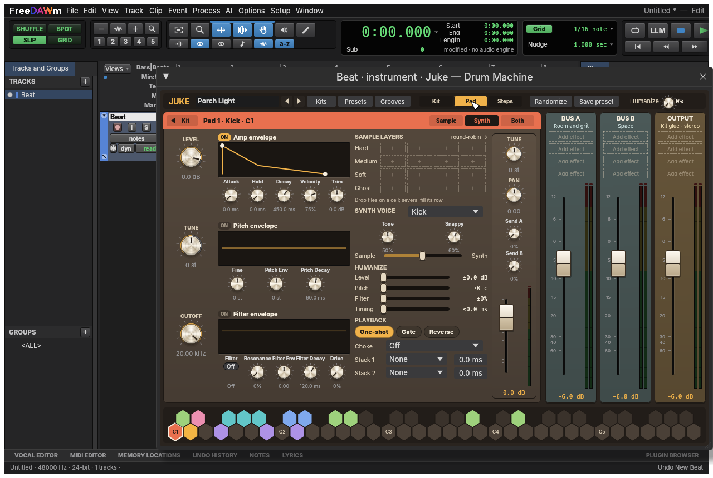
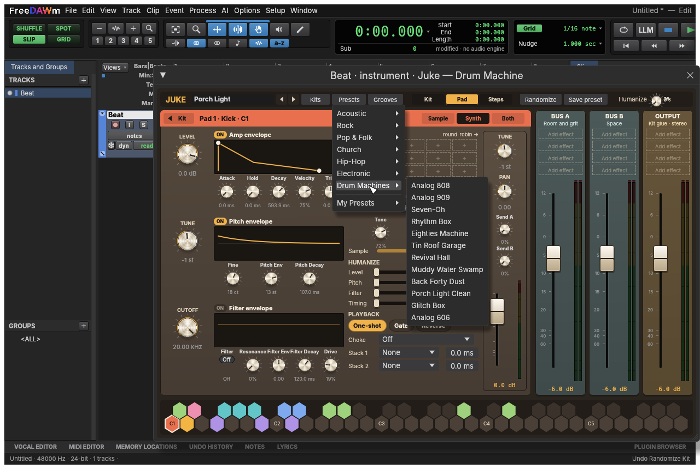

# Juke: drum machine and pattern clips (design)

> **Status:** design, approved for phase 1 · **Written:** 2026-11-06 · **Owner decisions
> (2026-11-06):** the name Juke; pads and a step grid both; patterns as clips on the timeline
> (pattern-backed MIDI clips); 16 pads; one stereo output; two effects buses with four FireStation
> slots each, every pad sending to both, and four more slots on the output; starter kits both
> synth-rendered and recorded; the kit view's look (below)

FreeDAWm gets **Juke**, a drum machine that plays samples and synthesized voices from one set of
16 pads, and a step sequencer whose patterns are clips on an instrument track (**Juke patterns**,
edited in a step grid). The name follows the FireStation line's Southern theme: the juke joint,
where the South's dance rhythms were played. It is listed as **"Juke — Drum Machine"**, `Juke` in
insert slots, plugin id `juke`. Together they make a beat machine that bounces, freezes, exports
and undoes like everything else in the session.

## References

Four instruments the owner likes set the target. FreeDAWm takes their **workflows and feature
ideas**, implemented its own way, under its own names, with its own look and its own sounds. It
copies no samples, presets, artwork, layouts or names from any of them (`AGENTS.md`: never copy
resources out of another product). The products are named here only to say which workflows we mean;
FreeDAWm is not affiliated with their makers.

| Reference | What we take |
|---|---|
| Klevgrand OneShot2 | Slots as complete drum instruments from your own samples; velocity layers and round-robin; stack triggers (one note fires several slots: layers, flams); note-off cuts a one-shot; multi-out; later, sample morphing over time ("motion") |
| Roland TR-909 | Synthesized drum voices with a few musical controls each (tune, decay, attack, tone, snappy); the 16-step grid with accent, shuffle, flam and last step; chaining patterns |
| Sugar Bytes DrumComputer | Voices that layer synthesis and a sample; per-lane length, direction and step length (polymeter); probability, rolls, ± step delay, swing, humanize; generated patterns and fills; randomized sounds and kits; a modulation matrix |
| Softube Heartbeat | Fixed voice roles that make a kit quick to set up; per-voice reverb and a bus compressor; several layers from one trigger; patterns live in the DAW, not in the plugin |

## What exists today

- **Sampler** (`crates/dsp/src/plugins/sampler.rs`): one sample across the keyboard, 32 voices,
  key/velocity ranges, ADSR, start, forward/ping-pong loops, one-shot or gate. The sample is a session
  source (`Insert::sample`), saved in `Audio Files/`. (The parity docs still call it "PR #108 open":
  it is merged; fix in the first PR.)
- **Drum Synth** (`crates/dsp/src/plugins/drums.rs`): kick, snare, clap, closed/open hat (choke),
  toms, crash, ride on General MIDI notes, 24 voices, a dozen kit-wide parameters.
- **Plugin API** (`crates/dsp/src/lib.rs`): `note_on`/`note_off`/`midi` at sample offsets,
  `set_sample` (one sample) and `set_asset(key, …)` (keyed assets prepared off the audio thread).
- **MIDI clips** (`ClipContent::Midi { sequence }`, ticks at `soundcraft_midi::PPQ`), the piano roll,
  step input, and the Band's drummers, which already write drum parts.

## Architecture

### 1. The Juke instrument (`crates/dsp/src/plugins/juke/`)

A built-in instrument, plugin id `juke`, with **16 pads** (the model sized for 32, should a
bigger grid come later). Each pad:

- **Trigger:** a MIDI note (default: General MIDI drums, so Band drummers and imported MIDI play it
  unchanged), plus up to 3 **stacked** slots it also fires, each with an offset of 0–50 ms
  (flams) and a level.
- **Source**, one of:
  - **Sample:** up to 4 **velocity layers** × up to 4 **round-robin** variations (16 samples per
    slot), each a session source. Start offset, reverse, one-shot or gate (note-off cuts it, with
    the release time).
  - **Synth:** a voice type (kick, snare, clap, tom, hat, cymbal, rim, cowbell, noise), built from the
    Drum Synth's engines, extended with per-type controls in the 909 spirit (kick: tune, attack,
    decay, pitch sweep; snare: tune, tone, snappy, decay; …).
  - **Both:** the sample and the synth layered (DrumComputer), with a balance.
- **Shaping:** tune (±24 st, fine ±100 c), amp envelope (attack, hold, decay), velocity sensitivity,
  a multimode filter (LP/HP/BP, cutoff, resonance, velocity → cutoff), drive.
- **Output:** level, pan, **choke group** (1–8, open hat cut by closed hat), and **two sends**, one
  to each effects bus (pre or post the pad's level).
- **Effects buses (A and B):** each holds **four slots** for FireStation effects (Comp, Sat, Dist,
  Filter, Delay, Reverb, ChamberMade, Tape, …), run in order, with a return level. Every pad sends
  to both. The buses sum with the dry pads into **one stereo output** (no multi-out: a "split pads to
  tracks" command can come later if it is wanted).
- **Output:** **four slots** of its own for FireStation effects, run in order on the summed kit
  (the kit's glue: Comp, Tape or Sat, CleanQ, LevelUp), then the output level. They are part of the
  kit, so a kit preset carries its sound; processing that belongs to the mix stays on the track's
  inserts.
- **Kit-wide:** master level and humanize (small random level and timing per hit, seeded so a
  bounce is repeatable).

**Hosting effects inside the instrument** is new: Juke owns up to twelve instances of built-in
FireStation plugins (made through the registry, prepared with the instrument, run on its audio
thread with no allocation). Their parameters are stored with the insert (below), changed through a
command so they undo and automate. A filled slot opens that effect's **full detached plugin window**
(the floating editor every module already has), not a view embedded in Juke (owner's decision,
2026-11-06): nothing new to lay out, and each effect looks and works exactly as it does on a track.
This part is built after the pads and patterns work.

Engine and audio-thread rules stay as for every built-in: no allocation, no locks, no panics in
`process`. Voices are a fixed pool (64), stolen oldest-first within a slot.

**Parameters:** the registry's `ParamInfo` lists are static, so Juke's per-pad parameters are a
generated static table (`p1_tune` … `p16_pan`, the sends and bus return levels), the same `set_param`/automation/undo path as every
plugin. Slot names, trigger notes and sample assignments are not continuous parameters: they live in
the insert (below).

### 2. Session model (`crates/model`)

- `Insert::samples: BTreeMap<String, SourceId>` beside the existing `Insert::sample`: keyed session
  sources (`s3.v2.r1` = slot 3, velocity layer 2, round-robin 1). Saved with the session in
  `Audio Files/`, so a kit travels with its project; the engine hands each to the plugin with
  `set_asset` (keys and preparation as for the Amp's impulse responses, but from session sources).
- `Insert::kit: Option<KitLayout>`: per-pad names, trigger notes, stack targets, source kind and
  colour, and the two effects buses (each slot's plugin id and parameter values). Serde-defaulted, so
  older sessions open unchanged.
- **Pattern sidecar on MIDI clips:** `Clip::pattern: Option<Pattern>`, following the `CleanAlt`
  precedent (a sidecar beside the clip's content, not a new `ClipContent` variant, which would touch
  every clip edit). The pattern is the source of truth; the clip's `sequence` is its expansion,
  regenerated whenever the pattern, the clip's length or the tempo map changes. Everything that plays
  MIDI clips (playback, bounce, freeze, export, the Band's targets) works unchanged.

### 3. Pattern clips

A `Pattern` holds **lanes** (one per Juke pad, or any MIDI note on other instruments) and global
settings:

| Level | Settings |
|---|---|
| Pattern | steps per bar (16 default; 8/12/16/24/32), shuffle 0–100 % (909 style, on even 16ths), accent level, seed |
| Lane | note, length in steps (1–64, so lanes of different lengths make polymeters), direction (forward, reverse, ping-pong, random), step rate (1/32 to 1/4, triplets), mute |
| Step | on/off, velocity, accent, probability (0–100 %), micro-timing (±50 % of a step), roll/ratchet (1–4 hits), flam, condition (every Nth bar, first, not first, fill) |

**Expansion** turns a pattern into notes over the clip's length: lanes loop independently, shuffle
and micro-timing move notes, rolls and flams add notes, probability and humanize draw from a
generator seeded by `(pattern seed, bar number)`. So the dice roll differently from bar to bar but
**the same every playback and bounce**. A **Re-roll** command changes the seed. The **Fill** condition
plays on bars the clip marks as fills, or the last bar of every N.

**Editing:** the step grid edits the pattern; the clip's notes follow. Editing the expanded notes in
the piano roll detaches the clip (it becomes a plain MIDI clip; undo puts the pattern back), and the
piano roll says so first. **Convert to MIDI** detaches deliberately. Splits, trims, copies and loops
keep the pattern, with a phase offset so a trimmed pattern keeps its place in the bar.

### 4. Commands (`crates/engine/src/cmd/juke.rs`, `pattern.rs`)

Everything is a command, so the UI, MCP and the control channel share it:

- `mix.kit_slot` `{track, slot, name?, note?, source?: sample|synth|both, voice?, stack?: [...], choke?, color?}`
- `mix.kit_sample_load` `{track, slot, path, layer?, round_robin?}` / `mix.kit_sample_clear`
- `mix.kit_fx` `{track, bus: a|b|out, slot: 1-4, plugin?: id|null, params?: {...}, return?}`
- `mix.kit_randomize` `{track, slots?, amount?}` (DrumComputer: new sounds within each slot's role)
- `mix.kit_preset_save` / `mix.kit_preset_load` (a kit file holding its samples)
- `pattern.new` `{track, start, bars?, steps?}`: a pattern clip, empty or from a starter pattern
- `pattern.step` `{clip, lane, step, on?, velocity?, accent?, probability?, offset?, roll?, flam?, condition?}`
- `pattern.lane` `{clip, lane, note?, length?, direction?, rate?, mute?}` / `pattern.settings` `{clip, steps?, shuffle?, accent?}`
- `pattern.reroll` `{clip}`, `pattern.generate` `{clip, style?, density?}` (phase 2), `pattern.to_midi` `{clip}`

Instrument parameters go through the existing `mix.instrument_param`.

### 5. UI (`crates/ui-egui`)

As built (renders from the window tests, `SOUNDCRAFT_JUKE_PROOF_DIR`):

- **Juke window, kit view** (the instrument window for `juke`; look approved by the owner,
  2026-11-06, from the mockup canvas):
  - **Pads as channel strips:** a 3-column grid of pad cards (9 showing, scrolling to 16). Each
    card: a header band in the pad's **family colour** (dark text: name, note and source; icon
    buttons for Edit, Load, More); Tune and Pan as large knobs, Send A and Send B as small ones; a
    fader with a stereo meter; a footer with audition, the choke group, Solo and Mute. The selected
    pad has a cream outline.
  - **Family colours** (pad headers and trigger cells share them): kick coral `#E8704F`, snare
    amber `#F2B544`, clap pink `#EC8FB0`, hats teal `#62C6C8`, toms violet `#AE92E6`, cymbals blue
    `#7FA9EE`, percussion green `#9ED27C`.
  - **Right side:** three equal strips, Bus A and Bus B (slate) and Output (brass), each with four
    effect slots (a lit dot when filled, a dashed "Add effect" when empty; a filled slot opens that
    FireStation effect's full detached window), a full-height fader with a dB scale and a stereo meter, and the
    return or output level underneath.
  - **Knobs:** the app's knob (`widgets::paint_knob_face`) in a **cream** variant of its silver
    style (a brushed cream cap, dark pointer); Tune and Pan in the hero style, whose segmented value
    ring lights in amber from the centre.
  - **Faders and meters:** the Mix window's (`widgets::fader`, `widgets::meter`, the same taper),
    with the cap in the knobs' cream. The slot and the meters span the same height, so at either
    end of its travel the cap's edge is level with the meters' end. Bus and output caps 26 × 48 px,
    pad caps 18 × 30.
  - **Trigger notes:** a two-row honeycomb across C1–B5, white keys on the bottom row and each black
    key nested above between its neighbours (none between E–F and B–C). A note assigned to a pad is
    a solid cell in the pad's family colour, unassigned cells are dim, C cells carry the octave, and
    the selected pad's cell is ringed. Clicking a cell selects its pad; dragging a pad onto a cell
    moves its trigger note.
  - **Panels:** warm mid-tones (tobacco pad cards, slate buses, brass output on a walnut ground)
    so the knobs and faders sit on a surface; one amber accent for values and active states.
- **Pad edit view** (Edit on a pad; look approved 2026-11-06): the pad's card at full size, its
  header band in the family colour with a back-to-kit button, the name and note, and a
  Sample / Synth / Both switch. Three envelope rows (amp, pitch, filter), each with a hero knob
  (Gain, Tune, Cutoff), an on lamp, the curve in a dark inset well (amber, with cream handles to
  drag) and small knobs for its stages and velocity. A side column: the sample layers (4 velocity
  rows × 4 round-robin columns; filled cells in the pad's colour with a waveform, empty ones dashed
  drop targets), the synth voice (voice menu, its knobs, a sample↔synth blend), humanize sliders and
  playback options (one-shot or gate, reverse, stack, choke). At the side: the pad's own strip
  (Tune, Pan, sends, fader) beside the buses and the output, all four faders aligned.
  - **As built (2026-11-08):** each envelope row is titled with what it does ("Amp envelope — how
    the hit rises and dies away"); its ON lamp is lit while it shapes the pad (amp always; pitch with
    an amount, the filter when one is chosen) and switches the pitch sweep and the filter. The layer
    rows are named Hard, Medium, Soft and Ghost; several audio files dropped on a cell fill its row
    from there. The pad's own humanize (`p{n}_hum_level` ±dB, `_hum_pitch` ±cents, `_hum_filter`
    ±% of an octave on the cutoff, `_hum_timing` up to that many ms late) adds to the kit-wide
    Humanize. The top bar has **Randomize** (`mix.kit_randomize`: the pad shown in the pad view, else
    every pad: tuning, decay, tone, snap, drive and the kick and tom sweeps, around what they are)
    and **Save kit** (`mix.kit_save`: a kit folder with every setting, the samples as WAVs and the
    bus effects, written to the kits folder and listed in Kits › Recorded & saved). The bus strips
    carry their subtitles (Room and grit, Space, Kit glue · stereo).
- **Step grid** (the Juke window's **Steps** view, beside Kit and Pad; also the MIDI Editor's view
  of a pattern clip; look approved 2026-11-06): the Steps view lists the track's pattern clips as
  tabs (name and bars; `+ Pattern` adds an empty one after the last, `Duplicate` copies the one
  shown right after itself, to change for the next part of the song) over the pattern bar (name, steps per bar, **New steps** velocity, Shuffle,
  Accent and Humanize knobs, fill bars, Re-roll, Convert to MIDI); one row per lane, its header a band
  in the pad's family colour (name, lane length, choke or rate, mute); steps as raised keys grouped
  by beat. A step's fill height is its velocity in the lane's colour, a cream cap marks an accent,
  hatching with a percentage marks probability, ticks a roll, ◂ a flam, a dark badge a condition;
  a shorter lane's repeats are ghosted, and each lane's playhead step is outlined.
  - **Editing:** click a step to turn it on or off; drag across steps to paint or clear a run (the
    first step decides which); new steps take the **New steps** velocity (Full, 75, 50 or 25 %, chosen
    in the pattern bar); drag a step up or down for fine velocity; keys 1–4 over a step set it to
    Full / 75 / 50 / 25; right-click (or modifier-click) opens the step's details popover, hung from
    the step: Velocity, Probability and Nudge sliders, Roll 1–4, Accent and Flam pills, and when it
    plays (Always, 1st of 2, 2nd of 2, First pass, Fill bars, Not in fills). Steps per bar and New
    steps are segmented controls, Shuffle, Accent and Humanize cream dials, Fill every a menu; the
    step numbers run over the lanes and the gestures are listed under them. Track › New Beat, the
    Grooves menu and the Steps tab open this view.
- The menu bar gets **Track › New Beat** (an instrument track with Juke and a starter kit) and
  **Clip › Convert Pattern to MIDI**; `menubar.txt` and the parity checklist update with them.

### 6. Starter content

Kits must be original or permissively licensed, each with an `ATTRIBUTION.md` row in the same
commit. Both kinds ship (owner's decision):

- **Synth-rendered kits** (in the repository): each of Juke's synth voices rendered at several
  velocities and settings into samples, plus the synth-voice kits themselves. Original by construction.
- **Recorded kits** (downloaded): permissively licensed multi-velocity recordings, trimmed to
  Juke's 4 velocity layers × 4 round-robins. Candidates: **SM Drums** (public domain; the
  first choice), the **Karoryfer** kits (CC0: Big Rusty Drums, Swirly Drums with brushes), and, with
  a credit line, **Naked Drums** and the **DrumGizmo** kits (CC-BY-4.0). Each source's licence is
  checked on its download page before it is used. They are hundreds of megabytes, too big for the
  repository, so they ship like the ML models: a GitHub release asset, downloaded from inside the app
  (the same mechanism as `ml-models`), with a sha256 and the licence recorded per kit.

## Phases

| Phase | Scope | Estimate |
|---|---|---:|
| 1 | Juke (16 pads, sample and synth sources, layers, round-robin, choke, shaping, two effects buses and the output with four FireStation slots each); model fields; commands; Juke window; pattern clips with steps, accent, shuffle, flam, last step, per-lane length, probability, rolls, micro-timing, re-roll; step grid; Convert to MIDI; starter kits; tests | ≈ 45–70 h |
| 2 | Stack triggers UI depth, per-step parameter locks (Elektron-style: a step's own tune or decay), trigger conditions and fills, pattern generator, randomize kit, kit presets with samples, recorded kits beyond the first, "split pads to tracks" if wanted | ≈ 30–50 h |
| 3 | Motion (a slot morphs through samples over time, driven by an envelope, a controller or aftertouch), a modulation matrix, more synth voice types | ≈ 25–40 h |

**Phase 1 status (2026-11-06):** built, except the recorded kit. Juke, the pattern clips and the
step grid (in the MIDI Editor for a pattern clip), the Juke window (kit view, pad edit view,
honeycomb), Track › New Beat, the effects buses (`mix.kit_fx`; each effect is a module with an id
from `KitFx::module_id`, so the module commands and FireStation's full editors work on it) and five
starter kits (`mix.kit_load`, `mix.kit_list`; three rendered from Juke's own voices). The pads and
both buses meter through Juke's readouts (8-bit dB codes, three to a slot). Recorded kits: the
installed-kit format (a folder with `kit.json` and its WAVs, `juke_kits::RecordedKit`), loading one
(`mix.kit_load {path}`; a recorded pad plays its takes whole, at their own pitch), the kits release's
list and downloads (`soundcraft_ml::kits`) in the Kits menu, and `cargo xtask kit-package`. The first
recorded kit, **SM Drums** (16 pads × 4 velocity layers × 4 takes, 216 MB), is published in the
[`kits-v1` release](https://github.com/s0lidr0ck/FreeDAWm/releases/tag/kits-v1), built from the
authors' download by `.github/workflows/kits.yml` with `tools/kits/` (2026-11-07). Phase 1 is
complete.

**2026-11-08:** two more recorded kits from the same source, from the pieces SM Drums leaves out:
**SM Drums 17** (the 6.7" snare, a dry 6.5", pedal-open, loose and half-open hats, 15" and 17"
crashes, the 17" ride and bell) and **SM Drums Hybrid** (three hybrid snares and their rimshot);
the kits workflow builds, checks and publishes all three. **Characters** (`juke_kits::CHARACTERS`:
Tight, Punch, Big Room, Vintage, Lo-fi, Tuned Up, Tuned Down, Loose) lay settings and bus effects
over any kit as it loads (`mix.kit_load {…, character}`, listed by `mix.kit_list`); the Kits menu
offers each recorded or saved kit as recorded or with any character, so three recordings give 27
recorded kits.

**Presets (2026-11-08):** a preset is a whole kit sound, not just its samples
(`juke_presets.rs`, the library in `juke_presets.json`): a `source` (a starter or style kit, a
recorded kit, or Juke's defaults), pads `borrow`ed from other recorded kits, pad settings by family,
pad or `all` (tuning, envelopes, filter, drive, level, pan, sends, names), the kit's levels, and its
bus effects with their settings. `mix.kit_preset {preset | path}` loads one as one undo step,
`mix.kit_presets` lists the library (with the recorded kits each `needs`), and
`mix.kit_preset_save` writes the kit as a preset file: every parameter and effect, samples from
installed recorded kits named (`kit:<id>/<file>`) and any other sample copied beside it. The Juke
window's **Presets** menu lists the built-in presets (101 since the second pass: designed pad by
pad with full effect chains by `tools/kits/juke_presets.py`, each with a `demo` groove from the
styles, rendered, measured and levelled to one loudness; the tape, saturation and Vint circuits at
drives calibrated to be heard) in seven categories (Acoustic on the recorded
kits, Rock, Pop & Folk, Church, Hip-Hop, Electronic, Drum Machines) and **My Presets**; **Save
preset** saves the kit under its name. A preset whose recorded kit is missing is marked "(download)"
and says which kit to get.

Hours are agent-hours by the calibration in [`target-app-parity.md`](target-app-parity.md). The
three parts of phase 1 (instrument DSP, model plus commands, UI) can run as parallel agents once the
model fields are merged.

## Tests

- DSP: each voice deterministic for a given seed; velocity layer and round-robin selection; choke
  cuts within one block; stacks and flams at their offsets; no allocation in `process` (the existing
  allocation-counting test harness); silence in, silence out; parameter sweeps never produce NaN.
- Patterns: expansion is a pure function, property-tested (step count, lane lengths, probability 0
  and 100 %, shuffle bounds, every note inside the clip); expansion is identical across runs and
  between playback and bounce; trims and splits keep the phase; undo restores a detached pattern.
- Engine: a session with Juke and pattern clips bounces to the same audio twice; save and reopen
  keeps samples, layout and patterns; old sessions open unchanged.
- UI: snapshot tests of the Juke window and step grid (`ui_shot`), drag-and-drop of files onto slots.

## Decided

All four open questions are settled (2026-11-06): the name **Juke — Drum Machine**; **16
pads**; starter kits **both** synth-rendered and recorded; effects as **two buses with four
FireStation slots each**, every pad sending to both, and **four slots on the output**, into **one
stereo output**; the kit view's look as described in the UI section.
